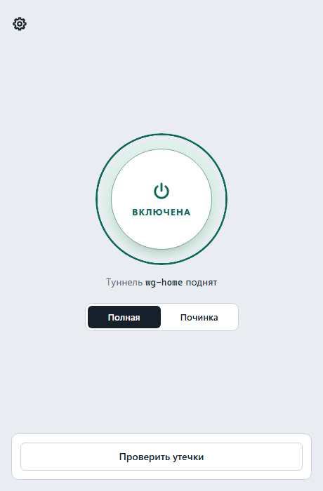
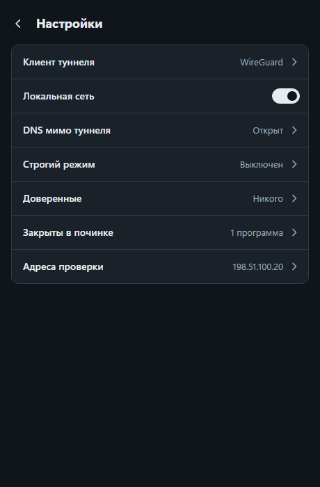

# killswitch

Киллсвитч туннеля: пока защита включена, программы выходят в сеть только через туннель. Упал туннель — выхода мимо
него нет. Один исполняемый файл на Go для Windows (WFP), macOS (pf) и Linux (nftables). Политика одна на все ОС,
клиенты туннеля описаны профилями-данными.

English summary — [в конце](#english).

Готовые сборки — на странице [Releases](https://github.com/DuchitskyDA/killswitch/releases): на Windows — один файл
двойным кликом, на macOS — `brew install --cask duchitskyda/tap/killswitch`. Можно собрать и из исходников (см.
[Установка](#установка)).

## Содержание

- [Что делает и чего не делает](#что-делает-и-чего-не-делает)
- [Установка](#установка)
- [Обновление и удаление](#обновление-и-удаление)
- [Окно](#окно)
- [Меню](#меню)
- [Команды и коды возврата](#команды-и-коды-возврата)
- [config.toml](#configtoml)
- [Профили клиентов](#профили-клиентов)
- [Проверка утечек: check](#проверка-утечек-check)
- [Известные ограничения](#известные-ограничения)
- [Что проверено вживую](#что-проверено-вживую)
- [Безопасность и аварийное снятие](#безопасность-и-аварийное-снятие)
- [Переход со старого скрипта на Windows](#переход-со-старого-скрипта-на-windows)
- [Лицензия](#лицензия)

## Что делает и чего не делает

В режиме `on` закрыт весь исходящий трафик машины на всех интерфейсах, кроме loopback и адаптеров туннеля. Открыто
только это:

- **адаптеры туннеля** — по шаблонам, которые сверяются с именем, alias и описанием адаптера (alias на Linux —
  `ifalias`, описание на macOS — имя аппаратного порта; на Windows без учёта регистра);
- **доверенные** — клиент туннеля, чтобы он дошёл до своего сервера: программа (Windows), пользователь (Linux, macOS),
  cgroup или метка пакета (Linux);
- **служебное**: DHCPv4/v6; на Linux и macOS ещё NDP и ICMPv6 «packet too big»;
- **локальная сеть** (`lan = true`, по умолчанию): 10.0.0.0/8, 172.16.0.0/12, 192.168.0.0/16, 169.254.0.0/16,
  fc00::/7, fe80::/10, а также mDNS и LLMNR;
- **DNS (порт 53) мимо туннеля** — по режиму `dns.mode`, см. [config.toml](#configtoml).

Блокируются все протоколы, а не только TCP и UDP. Новый интерфейс закрыт, пока наблюдатель не пересчитает правила.
Правила меняются атомарно: если загрузка набора не удалась, остаётся прежний. Сбой после загрузки (например, при
записи служебных файлов) даёт код 3, но действует уже новый набор; работающая служба доводит переход до конца. Если
новый набор разрешает больше прежнего (например, включена локальная сеть), при коде 3 это разрешение уже действует.
Поздний сбой `off` на Linux и macOS, наоборот, возвращает защиту: вместо снятия остаются правила `on`.

`off` и `repair` действуют до перезагрузки. После любой перезагрузки защита снова в режиме `on`. Совсем её снимает
только `uninstall`.

Наблюдатель `killswitch enforce` работает службой: Windows — служба `killswitch`, Linux — `killswitch.service`,
macOS — LaunchDaemon. Он пересчитывает правила раз в 60 секунд и при смене интерфейсов. Если кто-то снял наши правила,
он ставит их заново.

Чего killswitch не делает:

- **Только трафик самой машины.** Транзит (forward), контейнеры и виртуальные машины вне области. На Linux
  транзитные пакеты пропускаются отдельным правилом.
- **LAN — это список разрешённых назначений, а не проверенная локальная сеть.** Пакет к 10.1.2.3 через физический
  адаптер будет пропущен, даже если этот адрес не в вашей сети. Не нужна локальная сеть — `lan = false`.
- **Доверенный ходит мимо защиты.** Профили на Linux и macOS доверяют пользователю `root`: в режиме `compat` любой
  процесс root выходит куда угодно. Строгий режим (`trust_mode = "strict"`) пускает доверенных только к серверам
  туннеля.
- **Чужой адаптер с подходящим именем не отличить** от адаптера клиента. `status`, `check` и шапка меню показывают все
  совпавшие адаптеры и предупреждают (WARN), если совпало больше одного.
- **Защита во время загрузки ОС:**
  - Windows — без окна по замыслу. До старта службы фильтрации (BFE) действуют boot-time-фильтры: закрыто всё, кроме
    loopback и DHCP. Дальше — постоянный набор `on`. Холодная загрузка и порядок подслоёв WFP после перезагрузки вживую
    не проверены.
  - Linux — без окна по замыслу. Ранний юнит `killswitch-early.service` грузит `on.nft` до `network-pre.target`; если
    файл не загрузился — запасной набор, где открыт только loopback. Работает только с systemd: если `systemctl` нет,
    юниты не ставятся, и после перезагрузки защиты нет. Проверен перезапуск в network namespace, холодная загрузка — нет.
  - macOS — **окно есть.** После загрузки и до старта LaunchDaemon pf работает без наших правил. Окно закрывается,
    когда демон стартует. Холодная загрузка и работа при включённом SIP вживую не проверены.

## Установка

На Windows killswitch ставится одним файлом, на macOS — одной командой Homebrew, на Linux — вручную. Готовые сборки
лежат на странице [Releases](https://github.com/DuchitskyDA/killswitch/releases). У выпуска (с v0.2.0) там пять
бинарников `killswitch-<ос>-<арх>`, два архива `killswitch-darwin-arm64.zip` и `killswitch-darwin-amd64.zip`
с `killswitch.app` и `SHA256SUMS`. Перед запуском [сверьте сумму](#проверка-загрузки-sha256sums).

Защиту включает `on`: из окна, из меню («Включить защиту») или командой. Перед этим проверьте, что профиль или
`[[trust]]` доверяет клиенту туннеля. Иначе клиент не дойдёт до своего сервера, и выхода в сеть не будет совсем.

### Windows

Остановите клиент туннеля (почему — ниже) и дважды щёлкните по `killswitch-windows-amd64.exe`. Файл без подписи:
SmartScreen один раз покажет «Система Windows защитила ваш компьютер» — нажмите «Подробнее» → «Выполнить в любом
случае». Затем UAC спросит права администратора. Что делает установка:

1. создаёт `%ProgramFiles%\killswitch` (копия программы) и `%ProgramData%\killswitch` (state.json и config.toml) и
   задаёт обоим каталогам точные права: владелец — Администраторы, писать могут только Администраторы и SYSTEM,
   Пользователи — только читать и запускать; прежние записи прав не сохраняются, новый каталог создаётся сразу с этими
   правами. Если каталог уже есть и в него может писать не администратор, его владелец — не Администраторы, SYSTEM
   или TrustedInstaller или это ссылка, установка останавливается с «небезопасный каталог»: его содержимое мог подложить обычный пользователь.
   Проверьте и удалите каталог, затем запустите установку снова;
2. копирует себя в `%ProgramFiles%\killswitch\killswitch.exe`. Имя скачанного файла значения не имеет;
3. если это первая установка, а config.toml в `%ProgramData%\killswitch` уже есть (например, остался после
   удаления), сразу включает защиту (`on`);
4. регистрирует службу `killswitch` (`killswitch.exe enforce`, автозапуск, при сбое — перезапуск через 5 секунд) и
   запускает её;
5. кладёт на общий рабочий стол ярлык `killswitch`, который открывает [окно](#окно) с правами администратора;
6. добавляет killswitch в «Параметры → Приложения»;
7. открывает окно.

Без config.toml защита не включается: в окне задайте и сохраните настройки и включите защиту. Если установка не
удалась, причину покажет окно с ошибкой.

То же без окна — из PowerShell от имени администратора:

```powershell
.\killswitch-windows-amd64.exe install                         # установка
.\killswitch-windows-amd64.exe -config .\config.toml install   # сразу с настройками
& "$env:ProgramFiles\killswitch\killswitch.exe" status         # команды установленной программы
```

С `-config` при первой установке файл становится config.toml службы, и защита включается; при уже установленной
программе настройки заменяются, а режим остаётся прежним. Программа не попадает в
`PATH`: команды вызываются по полному пути, как в последней строке.

**Почему клиент туннеля должен быть остановлен.** WFP не держит два подслоя с весом 0xFFFF: созданный позже получает
0xFFFE. Свой подслой killswitch создаёт при первом применении правил (`on`, `off` или `repair`) и не пересоздаёт до
`uninstall`. Если в этот момент клиент (например, sing-box со `strict_route`) держит свой подслой 0xFFFF, наш так и
останется ниже до `uninstall`. Тогда разрешающее правило клиента пробьёт нашу блокировку, и `status`/`check` будут
показывать `LEAK wfp-tie`. Первое применение — при установке, если config.toml уже есть, иначе — первая кнопка в окне.
Запускайте клиент после него. Если уже поздно — удалите killswitch и установите заново при остановленном клиенте.

Команда `killswitch on` без установки тоже ставит постоянные фильтры, но службы нет: никто не пересчитает правила,
когда адаптер туннеля пересоздастся. Ставьте программу установкой.

### macOS

```sh
brew install --cask duchitskyda/tap/killswitch
```

Cask ставит `killswitch.app` в «Программы» и снимает с него пометку карантина: программа без подписи Apple, и иначе
macOS не дала бы её открыть. Откройте killswitch из «Программ» или Launchpad. Системное окно спросит пароль
администратора (Touch ID для программ без подписи не предлагается), затем откроется [окно](#окно) в браузере по
умолчанию. Значка в Dock нет.

Первая `on` копирует бинарник и `pfctl` (под именем `killswitchd`) в `/Library/Application Support/killswitch/`. Ещё она
ставит LaunchDaemon `/Library/LaunchDaemons/io.github.duchitskyda.killswitch.plist`: запуск при загрузке, а если
наблюдатель завершился — перезапуск не позже чем через 10 секунд; журнал — `/var/log/killswitch.log`. Правила загружаются в якорь pf `com.apple/000.killswitch`.

Программа из терминала (каталог программ по умолчанию — `/Applications`):

```sh
sudo /Applications/killswitch.app/Contents/MacOS/killswitch          # меню
sudo /Applications/killswitch.app/Contents/MacOS/killswitch status   # команды
```

Без Homebrew. Архив `killswitch-darwin-<арх>.zip`: распакуйте, перенесите `killswitch.app` в «Программы» и снимите
карантин: `xattr -dr com.apple.quarantine /Applications/killswitch.app`. Или один бинарник, без `.app`:

```sh
sudo install -m 0755 killswitch-darwin-arm64 /usr/local/bin/killswitch   # на Intel — killswitch-darwin-amd64
sudo killswitch            # меню; или sudo killswitch on при готовом config.toml
sudo killswitch window     # то же в окне
```

### Linux

```sh
sudo install -m 0755 killswitch-linux-amd64 /usr/local/bin/killswitch   # на arm64 — killswitch-linux-arm64
sudo killswitch            # меню: «Настройки» → «Применить и сохранить» → «Включить защиту»
sudo killswitch window     # то же в окне, если есть графический сеанс
```

Первая `on` кладёт копию бинарника в `/var/lib/killswitch/bin/killswitch`, а постоянный набор правил — в
`/var/lib/killswitch/on.nft`. Ещё она ставит и включает `killswitch-early.service` и `killswitch.service` в
`/etc/systemd/system`. Нужны `nft` и `ip`, для защиты при загрузке и наблюдателя — systemd.

### Проверка загрузки (SHA256SUMS)

Скачайте свой файл и `SHA256SUMS` того же выпуска и сверьте сумму:

- Windows (PowerShell): `(Get-FileHash .\killswitch-windows-amd64.exe -Algorithm SHA256).Hash` — значение должно
  совпасть без учёта регистра с суммой этого файла в `SHA256SUMS`;
- macOS: `shasum -a 256 killswitch-darwin-arm64.zip` (на Intel — `killswitch-darwin-amd64.zip`, без `.app` — бинарник
  `killswitch-darwin-<арх>`) — строка должна совпасть со строкой этого файла в `SHA256SUMS`. При установке через
  Homebrew сверять не нужно: brew сверяет zip с суммой, записанной в cask;
- Linux: `sha256sum -c --ignore-missing SHA256SUMS`.

### Сборка из исходников

Нужен Go 1.26 или новее:

```sh
git clone https://github.com/DuchitskyDA/killswitch
cd killswitch
go build -o killswitch ./cmd/killswitch        # на Windows: -o killswitch.exe
```

Под другую ОС — как в CI: `CGO_ENABLED=0 GOOS=windows GOARCH=amd64 go build -trimpath -o killswitch.exe ./cmd/killswitch`.
Поддержаны linux/amd64, linux/arm64, darwin/arm64, darwin/amd64 и windows/amd64. `killswitch.app` собирает
`ci/darwin/app.sh` (только на macOS).

**Иконка.** Исходник — `dist/icon/icon.svg`; готовые `.ico`, `.icns`, ресурс exe (`cmd/killswitch/rsrc_windows_amd64.syso`)
и значок окна (`web/src/favicon.ico`) лежат в репозитории, сборка их не создаёт. После правки svg: `sh dist/icon/render.sh`
(нужен resvg 0.45) и `cd dist/icon/gen && go run .`, затем пересоберите страницу окна (см. «Окно»).

**Артефакты CI.** Сборку любого коммита можно взять из CI: каждый прогон workflow `ci` собирает те же файлы, что лежат
в выпуске. Они лежат в артефакте `killswitch-<коммит>` на странице прогона во вкладке Actions (скачать может только
вошедший в GitHub). Суммы сверяются так же, как у готовых сборок.

## Обновление и удаление

**Обновление.** Режим защиты при обновлении не меняется: была включена — остаётся включённой, была выключена до
перезагрузки — так и остаётся.

- Windows: запустите новый `killswitch-windows-amd64.exe` двойным кликом (или `install` из консоли администратора). Он
  заменит копию в `%ProgramFiles%\killswitch`, обновит службу, ярлык и запись в «Приложениях». Открытое окно не мешает.
- macOS: `brew upgrade --cask killswitch`. Homebrew снимает прежнюю версию и ставит новую: на эти несколько секунд
  защиты нет, затем прежний режим возвращается.

**Удаление.**

- Windows: «Параметры → Приложения → Установленные приложения» → killswitch → «Удалить», или в PowerShell
  `& "$env:ProgramFiles\killswitch\killswitch.exe" uninstall`. Снимаются служба, правила, ярлык, запись в «Приложениях» и
  `%ProgramFiles%\killswitch`. Настройки в `%ProgramData%\killswitch` остаются: следующая установка сразу включит
  защиту с ними (удалите каталог, если они не нужны). Удаление из «Приложений» ошибку не показывает: если запись
  осталась, запустите ту же команду из консоли администратора, она напечатает причину.
- macOS: `brew uninstall --cask killswitch` снимает LaunchDaemon, якорь pf, токены и копию программы в
  `/Library/Application Support/killswitch`. config.toml там остаётся; следующая установка защиту сама не включает.
  `brew uninstall --cask --zap killswitch` удаляет также `/Library/Application Support/killswitch` и
  `/var/log/killswitch.log`. Без Homebrew — `sudo /Applications/killswitch.app/Contents/MacOS/killswitch uninstall`
  (или `sudo killswitch uninstall` для бинарника), затем удалите `killswitch.app` или `/usr/local/bin/killswitch`.
- Linux: `sudo killswitch uninstall`, затем удалите `/usr/local/bin/killswitch`.

Если снятие не удалось, см. [аварийное снятие](#безопасность-и-аварийное-снятие).

## Окно

`killswitch window` открывает окно с теми же действиями, что меню: состояние защиты, режимы, проверка утечек и
настройки. Окно — страница, встроенная в бинарник. Её отдаёт сам killswitch с адреса `127.0.0.1` на случайном порту,
наружу этот адрес не виден. Нужны права администратора:

- Windows: ярлык `killswitch` на рабочем столе открывает окно сразу от имени администратора; установка открывает его
  сама. Из консоли — `killswitch window`: без повышения killswitch перезапускает себя через UAC. Окно открывается в
  Microsoft Edge без адресной строки и вкладок, в отдельном профиле `%LOCALAPPDATA%\killswitch\window`. Нет Edge —
  страница открывается в браузере по умолчанию.
- macOS: откройте `killswitch.app` — пароль спросит системное окно. Из терминала —
  `sudo /Applications/killswitch.app/Contents/MacOS/killswitch window` (бинарник — `sudo killswitch window`); без sudo
  killswitch тоже спросит пароль системным окном.
- Linux: `sudo killswitch window`.

На Linux и macOS страница открывается в браузере по умолчанию от имени пользователя, который запустил killswitch, а не
от root.

Пока окно открыто, работает процесс `killswitch window`: на Windows это свёрнутое окно консоли. Закройте окно или
вкладку — процесс завершится сам: обычно через несколько секунд, самое большее через полторы минуты. Ctrl+C в консоли
завершает его сразу. Свёрнутое окно продолжает работать.

Чем защищена страница:

- адрес открывается одноразовым ключом из 32 случайных байт. По ключу браузер получает cookie сеанса, без неё любой
  запрос получает 401. Второй раз ключ не работает: если его предъявит кто-то ещё, окно закрывается с ошибкой;
- запросы с чужих страниц отвергаются (403): сервер сверяет заголовки `Host`, `Origin` и `Sec-Fetch-Site`;
- страница не грузит ничего извне и не кешируется.

Если браузер не запустился, killswitch печатает адрес с ключом: откройте его вручную на этой же машине. Окно, которое
никто не открыл за две минуты, завершается с кодом 3.

На Linux без графического сеанса (сервер, вход по SSH) окна нет: `killswitch window` отвечает «окно не открыть: нет
графического сеанса» с кодом 2. Там работают меню и команды.

Ключ `-config` на окно не влияет: как и меню, оно работает с config.toml из каталога состояния.

 

**Что в окне.** Большая кнопка включает и выключает защиту; цвет кольца и слово на кнопке показывают состояние. Под
кнопкой — адаптеры туннеля и переключатель режима «Полная | Починка»: при включённой защите он применяется сразу, при
выключенной — выбирает, что включит кнопка. Внизу — «Проверить утечки» с итогом; таблица проб раскрывается по
«Подробнее». Шестерёнка открывает настройки — те же пункты, что в меню.

**Сборка страницы.** Исходники страницы лежат в `web/` (Svelte, Vite). Собранные файлы — в `internal/window/dist`: они
входят в репозиторий и встраиваются в программу, поэтому для сборки killswitch Node.js не нужен. После правки `web/`
пересоберите страницу: `cd web && npm ci && npm run build` — и закоммитьте изменения `internal/window/dist` вместе с
исходниками. Проверки: `npx svelte-check`, `npm test`. CI собирает страницу заново и падает, если результат отличается
от закоммиченного.

## Меню

`killswitch` без аргументов в терминале открывает меню. Оно одно на трёх ОС. Нужны права администратора:

- Windows: без повышения killswitch перезапускает себя через UAC, и меню открывается в новом окне консоли. Ярлык на
  рабочем столе открывает не меню, а [окно](#окно), а двойной клик по `killswitch.exe` — [установку](#windows).
- Linux и macOS: `sudo killswitch` (на macOS из cask — `sudo /Applications/killswitch.app/Contents/MacOS/killswitch`).
  Без root меню отвечает с кодом 2: на Linux — «нужны права root: запустите sudo killswitch», на macOS — «права
  администратора не получены: меню работает в терминале: запустите sudo killswitch».

Меню нужен настоящий терминал: запускайте его из PowerShell, cmd или Windows Terminal. В Git Bash и mintty на Windows
пользуйтесь командами.

Шапка: `killswitch — защита: <режим>, туннель: <адаптеры>`. Режим — «ВКЛ (on)», «ВЫКЛ до перезагрузки (off)»,
«починка до перезагрузки (repair)», «не включена» или «правила не загружены». У каждого совпавшего адаптера стоит
▲ (поднят) или ▼ (опущен). Ниже идут строки WARN и LEAK по тем же признакам, что у `status`.

Главный экран (пункты выбираются номером):

- **Включить защиту** — `on`;
- **Починка туннеля** (только Windows) — `repair`: выход открыт всем, кроме программ из списка «Закрыты в починке»;
- **Выключить до перезагрузки** — `off`;
- **Проверить утечки** — `check`;
- **Настройки ▸**;
- 0 — выход. Пока настроек нет, первые пункты отвечают: «нет настроек — откройте «Настройки» и выберите «Применить и
сохранить»».

Настройки — все ключи config.toml:

- **Клиент туннеля**: «Найти автоматически» (по `detect` профилей), «Выбрать из списка» или «Без профиля», а также
  «Адаптеры туннеля» (`[tunnel] interfaces`);
- **Локальная сеть** — `lan`;
- **DNS** — `dns.mode`: open, tunnel-up (спросит адрес `dns.health`) или свои резолверы. На Linux при выборе tunnel-up
  меню предупреждает, что с sing-box `auto_redirect` этот режим не поднимается;
- **Строгий режим** — `trust_mode` и серверы туннеля (`[tunnel] endpoints`);
- **Доверенные** — `[[trust]]`, только виды, которые умеет ОС;
- **Закрыты в починке** (только Windows) — программы, которым закрыт выход в режиме `repair`:
  - «По имени» — `[repair] names`: наберите имя программы, например `node`; её файлы killswitch находит сам;
  - «Выбрать из запущенных» — список запущенных программ с путями; выбранная добавляется по имени;
  - «По пути» — `[repair] programs`: точный путь или шаблон;
- **Адреса для проверки утечек** — `[check] targets`; пока не заданы, `check` делает простую проверку;
- **Применить и сохранить**.

Правки копятся в черновике. «Назад» с несохранёнными правками спросит подтверждение. «Применить и сохранить» проверяет
конфиг тем же путём, что `on`: разбор, профиль, проверка, снимок машины, план. При ошибке файл не пишется, а меню
показывает текст ошибки. При успехе меню атомарно записывает `config.toml` в каталог состояния и применяет текущий
режим. Если защита ещё не установлена, файл сохраняется без применения: «сохранено; защита не включена». Если
применить не удалось, файл уже записан: «сохранено, но не применено».

**Комментарии в config.toml пропадают:** меню пишет файл заново. Нужны комментарии — правьте файл руками и применяйте
командой `on`.

## Команды и коды возврата

```
killswitch [-config путь] <команда>
```

По умолчанию config.toml лежит в каталоге состояния: `%ProgramData%\killswitch` (Windows),
`/Library/Application Support/killswitch` (macOS), `/var/lib/killswitch` (Linux). Если `on`/`off`/`repair` вызвали с
`-config`, после принятого плана файл копируется туда: служба читает именно его.

| Команда | Что делает |
|---|---|
| `on` | включить защиту |
| `off` | выключить до перезагрузки |
| `repair` | только Windows: открыть всё, кроме программ из `[repair]`, до перезагрузки |
| `status` | режим, поколение, фильтры, совпавшие адаптеры, файлы программ починки по именам, WARN и LEAK |
| `check` | пробы утечки, см. [check](#проверка-утечек-check) |
| `detect` | найти установленные клиенты по `detect` профилей |
| `window` | открыть [окно](#окно): состояние, режимы, проверка и настройки на локальной странице |
| `plan [on\|off\|repair]` | напечатать правила без применения; по умолчанию — записанный режим или on |
| `enforce` | наблюдатель; его запускает служба |
| `install` | Windows: [установка](#windows) без окна; на других ОС ничего не делает |
| `uninstall` | снять всё наше без конфига и без сети, удалить state.json; на Windows — ещё службу, ярлык, запись в «Приложениях» и `%ProgramFiles%\killswitch` |

Коды возврата:

| Код | Значение |
|---|---|
| 0 | успех; у `check` — все пробы BLOCKED (в простой проверке — утечек не найдено) |
| 2 | ошибка конфига или аргументов: неизвестная команда, неверный ключ, неподдержанное на этой ОС, нет терминала для меню, нет графического сеанса для окна |
| 3 | ошибка применения или backend: снимок машины, правила, замок, state.json; окно никто не открыл |
| 4 | утечка: `check` нашёл LEAK; `status` и `check` — структурная находка |
| 5 | у `check` нет уверенности: есть INCONCLUSIVE или не было ни одной пробы |

`detect` всегда возвращает 0. `enforce` не выходит из-за ошибки шага: он печатает её и пробует снова.

## config.toml

Неизвестный ключ — ошибка с кодом 2. Ключ конфига **заменяет** значение профиля целиком, списки не сливаются: свой
`[[trust]]` убирает доверенных из профиля. Повторите их, если они нужны.

```toml
profile = "wireguard"   # встроенный профиль; без него обязателен [tunnel] interfaces
lan = true              # локальная сеть; по умолчанию true
trust_mode = "compat"   # compat (по умолчанию) — доверенные куда угодно; strict — только к endpoints

[tunnel]
# interfaces = ["wg0"]  # шаблоны (* и ?) по имени, alias или описанию; заменяет адаптеры профиля на этой ОС целиком
endpoints = ["203.0.113.5:51820/udp", "tunnel.example.org:443/tcp", "[2001:db8::5]:443/tcp"]

# Свой [[trust]] заменяет доверенных профиля целиком (у wireguard на Linux — метку 0xca6c):
# [[trust]]
# kind = "mark"         # program — Windows; user — Linux, macOS; cgroup, mark — Linux
# value = "0xca6c"
# destinations = "any"  # any | endpoints; не задано — any в compat, endpoints в strict

[dns]
mode = "open"           # open | tunnel-up | resolvers
# health = "http://198.51.100.10:80/"   # только для tunnel-up, обязателен
# resolvers = ["192.168.1.1", "10.0.0.0/8"]  # только для resolvers, обязателен

[repair]                      # только Windows; что закрыть в режиме repair
names = ["node"]              # по имени: файлы программы находятся сами
# programs = ['C:\Program Files\Example\app.exe']   # по пути или шаблону

# [check]
# targets = ["198.51.100.20"]   # свои хосты для полной проверки; без них check делает простую (см. ниже)
```

Ключи:

- `profile` — имя встроенного профиля (список — `killswitch detect` или меню).
- `lan` — разрешить назначения LAN (список выше). DNS это не открывает: порт 53 живёт по своим правилам.
- `trust_mode` — `compat` или `strict`. В strict нужен хотя бы один `endpoints`, а `destinations = "any"` запрещён.
- `[tunnel] interfaces` — шаблоны адаптеров туннеля. Должен быть хотя бы один, из профиля или из конфига.
- `[tunnel] endpoints` — серверы туннеля `адрес:порт/tcp|udp`, IPv6 в скобках. Имя разрешается при планировании,
  наблюдатель разрешает его заново. Если разрешить не удалось, берутся последние известные адреса из state.json; если
  их нет, к этому имени не открывается ничего, а `status` пишет WARN. Серверы открыты **только доверенным**: сами по себе
  `endpoints` никому выход не дают.
- `[[trust]]` — исключения. `kind` и `value`:
  - `program` (Windows): путь или шаблон exe. Можно `%ProgramFiles%`, `%LOCALAPPDATA%`, `%APPDATA%`, `%USERPROFILE%`;
    пользовательские переменные раскрываются по всем профилям пользователей. Доверять `svchost.exe` нельзя — ошибка 2;
  - `user` (Linux, macOS): имя или uid. Неизвестное имя: на Linux — ошибка 2, на macOS исключение пропускается
    (меньше доступа);
  - `cgroup` (Linux): путь cgroup v2 относительно `/sys/fs/cgroup`, можно шаблон, например `system.slice/xray.service`;
  - `mark` (Linux): метка пакета `значение` или `значение/маска`, десятичная или `0x…`.

  Вид, который не умеет ОС, — ошибка 2, без молчаливой замены.
- `[dns] mode` — DNS (TCP и UDP 53) мимо туннеля, через физические адаптеры. Через туннель DNS открыт всегда.

  | Режим | Состояние туннеля | К LAN | К системным резолверам | К прочим |
  |---|---|---|---|---|
  | `open` (по умолчанию) | любое | да | да | нет |
  | `tunnel-up` | не проверен или упал | да | да | нет |
  | `tunnel-up` | жив | нет | нет | нет |
  | `resolvers` | любое | только перечисленные | только перечисленные | только перечисленные |

  Системные резолверы — DNS-серверы физических адаптеров, полученные по DHCP или заданные вручную: Windows — DNS
  адаптера, Linux — `nameserver` из resolv.conf (кроме loopback и тех, что за туннелем), macOS — `scutil --dns`.

  `tunnel-up` нужен, чтобы при живом туннеле DNS не уходил в локальную сеть, а при упавшем клиент мог заново разрешить
  имя своего сервера. Туннель считается живым по `dns.health`, адресу вида `http://<ip>:<порт>/<путь>`. Это сервер за
  туннелем, который отвечает по HTTP. Наблюдатель раз в 5 секунд делает к нему GET через туннель с таймаутом 3 секунды.
  «Жив» — два успеха подряд, первый не меньше 10 секунд назад; «упал» — три провала подряд, около 15 секунд. Без
  работающей службы `enforce` состояние неизвестно и `tunnel-up` ведёт себя как `open`.
- `[repair]` (только Windows) — что закрыть в режиме `repair`, остальное открыто. Нужна хотя бы одна запись в `names`
  или `programs`. Профили клиентов эти списки не заполняют: программа клиента в них закрыла бы сам туннель.
  - `names` — имена программ без пути и расширения: `node`, а не `node.exe` и не `C:\...\node.exe`. При `repair` и при
    каждом повторном применении правил killswitch находит файлы с таким именем: среди запущенных программ и в обычных
    местах установки для всех пользователей — `%ProgramFiles%` и `%ProgramFiles(x86)%` (до двух папок вглубь),
    `%LOCALAPPDATA%\Programs` (до трёх) и `%USERPROFILE%\.local\bin`. Какие файлы найдены, показывают `plan repair` и
    `status`: строки `починка: <имя> — <пути>`. Имя, по которому ничего не найдено, — предупреждение, починка
    продолжается. Если файлов нет ни по одной записи списка — ошибка 2.
  - `programs` — пути или шаблоны exe, переменные те же, что у `[[trust]]`. Шаблон, не нашедший ни одной программы, —
    ошибка 2.

  Программа, которая лежит в необычном месте и не запущена, по имени не найдётся: запустите её или задайте путь в
  `programs`. Если она запустится уже в режиме починки, служба закроет её на ближайшем шаге — до минуты.
- `[check] targets` — IP-адреса своих хостов для полной проверки `check`. Не заданы — простая проверка.

### Частые случаи

- **Портативный клиент на Windows** (v2rayN из zip, sing-box без установщика). Каталог распаковки профиль не знает,
  поэтому задайте программу сами:

  ```toml
  profile = "v2rayn"

  [[trust]]
  kind = "program"
  value = 'D:\Tools\v2rayN\bin\*\*.exe'
  ```

- **Hiddify в режиме моста на Linux и macOS.** В этом режиме к серверу ходит приложение от пользователя рабочего стола.
  Доверия по программе на этих ОС нет, поэтому доверьте пользователя и сохраните `root` из профиля:

  ```toml
  profile = "hiddify"

  [[trust]]
  kind = "user"
  value = "root"

  [[trust]]
  kind = "user"
  value = "1000"     # uid пользователя рабочего стола (id -u)
  ```

- **WireGuard в ядре Linux без wg-quick** (через `wg setconf`, systemd-networkd и т. п.) с маршрутом по умолчанию через
  туннель. Пакеты ядра WireGuard идут без пользователя сокета, поэтому доверие возможно только по метке. Профиль
  `wireguard` доверяет метке 0xca6c: её ставит wg-quick при `Table = auto`. Задайте ту же метку в конфиге WireGuard
  (`FwMark = 0xca6c`) или свою метку в `[[trust]]`:

  ```toml
  profile = "wireguard"

  [[trust]]
  kind = "mark"
  value = "0x1234"
  ```

## Профили клиентов

Встроенные профили (`profiles/*.toml`, вшиты в бинарник):

| Профиль | Windows | Linux | macOS |
|---|---|---|---|
| `amneziawg` | адаптер `WireGuard Tunnel*`, `amneziawg.exe` | `awg*`, метка 0xca6c | `utun*`, root |
| `happ` | `happ-xray`, `happ-tun`, `happ-default-tun`, exe каталога Happ | `happ-xray`, `happ-tun`, `happ-wg`, root | `utun*`, root |
| `hiddify` | `HiddifyAdminBg`, `sing-tun Tunnel*`, exe каталога Hiddify | `HiddifyAdminBg`, `tun*`, root | `utun*`, root |
| `openvpn` | `OpenVPN TAP-Windows6`, `OpenVPN Data Channel Offload` (и с суффиксом ` #N`), `openvpn.exe` | `tun*`, root | `utun*`, root |
| `sing-box` | `sing-tun Tunnel*`, программу задайте сами | `tun*`, root | `utun*`, root |
| `v2rayn` | `singbox_tun`, ядра в `%LOCALAPPDATA%\v2rayN\bin` | `singbox_tun`, root | `utun*`, root |
| `wireguard` | `WireGuard Tunnel*`, `wireguard.exe` | `wg*`, метка 0xca6c | `utun*`, root |

Профиль даёт три вещи: шаблоны адаптеров, доверенных (программы на Windows, пользователей и метки на Linux и macOS) и
`detect` — пути, по которым клиент находится на диске.

`verified_on` — список живых проверок именно с данными этого профиля: ОС, backend, версия клиента, дата. Пусто —
профиль составлен по исходникам и документации клиента, но вживую с killswitch не проверялся. Сейчас отметки есть
у `wireguard` и `sing-box` на Linux (см. [что проверено](#что-проверено-вживую)).

### Как добавить свой профиль

Профиль — файл `profiles/<имя>.toml`; поле `name` совпадает с именем файла. Формат — все ключи (секцию ОС, где клиента
нет, не пишите):

```toml
name = "myclient"
description = "Мой клиент: адаптер myclient-tun"
# Живые проверки с данными этого профиля; пусто — не проверен.
verified_on = []   # или [{ os = "linux", backend = "nftables", client_version = "1.2.3", date = "2026-01-31" }]

[windows]
interfaces = ["myclient-tun"]                     # шаблоны адаптеров: имя, alias или описание
programs = ['C:\Program Files\MyClient\*.exe']    # доверенные программы (app-id)
detect = ['C:\Program Files\MyClient\MyClient.exe']
# repair_programs = [...] — что закрыть в repair; клиентские профили его не заполняют:
# программа клиента в этом списке закрыла бы сам туннель. Список задаёт пользователь — [repair] programs.

[linux]
interfaces = ["myclient*"]
users = ["root"]                  # доверенные пользователи (имя или uid)
# cgroups = ["system.slice/myclient.service"]   # доверенные cgroup v2 (от /sys/fs/cgroup)
# marks = ["0xca6c"]                            # доверенная метка пакета: значение или значение/маска
detect = ["/usr/bin/myclient"]

[darwin]
interfaces = ["utun*"]
users = ["root"]
detect = ["/Applications/MyClient.app"]
```

Неизвестный ключ — ошибка. `detect` — шаблоны путей: найден любой — клиент установлен.
Профили встраиваются при сборке, поэтому после правки соберите бинарник заново. Без пересборки те же данные можно
задать в config.toml: `profile` не указывать, `[tunnel] interfaces` и `[[trust]]` — свои.

## Проверка утечек: check

`check` не снимает защиту. Он проверяет, что прямой выход через физические адаптеры закрыт. Проверок две: простая — без
настройки, и полная — со своими хостами.

### Простая проверка

Работает, пока `[check] targets` не заданы. Своих серверов не нужно: `check` обращается по HTTP к `example.com` (порт
80) с каждого поднятого физического адаптера и обычным путём — так, как ходит любая программа.

| Что получилось | Вывод | Код |
|---|---|---|
| с физического адаптера пришёл ответ | `LEAK … сервер ответил мимо туннеля`, `УТЕЧКА (простая проверка)` | 4 |
| с физических ответа нет, обычным путём сайт отвечает | `утечек не найдено (простая проверка)` и оговорка ниже | 0 |
| ответа нет и обычным путём, имя не разрешилось или ни одной пробы не было | `нет уверенности (простая проверка): <причина>` | 5 |

При коде 0 `check` всегда добавляет: «проверен только TCP; UDP и DNS не проверялись — для полной проверки задайте свои
адреса ([check] targets)». Простая проверка слабее полной:

- проверяется один сайт и только TCP 80; UDP и DNS мимо туннеля она не видит;
- «ответа нет» принимается без свидетельства, что пакет отбросило именно наше правило: молчание адаптера по любой
  другой причине (нет интернета на этом адаптере, сайт недоступен у провайдера) выглядит так же;
- если клиент туннеля подменяет адреса имён служебными (fake-ip), проба к такому адресу бессмысленна: `check` отвечает
  «нет уверенности» и советует задать свои адреса;
- запрос уходит на чужой сайт `example.com`; имя разрешает системный резолвер.

Пропуски (SKIPPED) и структурные находки — те же, что в полной проверке.

### Полная проверка

Нужны цели: `[check] targets` — IP-адреса хостов, которые вы контролируете. На них должны слушать HTTP 80/tcp, UDP-эхо
на 443 и DNS 53 (udp и tcp). Полная проверка требует свидетельства, что пакет отбросило **наше** правило.

Для каждой цели и каждого сервиса:

1. **Baseline через туннель:** цель должна ответить через поднятый адаптер туннеля. Нет ответа — проба INCONCLUSIVE
   («туннель не поднят» или «цель не ответила через туннель»).
2. **Прямая проба** через каждый поднятый физический адаптер. Сокет привязан к адаптеру, порт-источник — из диапазона
   30000–30063.

Классы:

- **BLOCKED** — ответа нет, и есть свидетельство, что пакет отбросило наше правило: счётчик правила (Linux, macOS) или
  событие отброса WFP с id нашего фильтра (Windows). Просто «нет ответа» — ещё не BLOCKED.
- **LEAK** — сервер ответил мимо туннеля.
- **INCONCLUSIVE** — нет уверенности: baseline не прошёл, нет свидетельства отброса, проба не ушла.
- **SKIPPED** (пропуск с пометкой, в итог не входит):
  - «нет адреса v4/v6 на интерфейсе» — семейства на адаптере нет;
  - «нет маршрута по умолчанию v4/v6 через интерфейс» — например, `vEthernet (nat)` Hyper-V/WSL или мост контейнеров:
    через такой адаптер в интернет не выйти. Если маршрута по умолчанию нет ни у одного физического адаптера, check
    выдаёт строку INCONCLUSIVE с подсказкой;
  - «перехвачено клиентом туннеля, через физический адаптер не ушло» (только Linux): клиент перенаправил пробу к себе,
    например sing-box `auto_redirect`, а счётчик показал, что через физический адаптер пакет не ушёл. Если перехвачены
    все пробы, итог — INCONCLUSIVE. Если наши правила сняты, это ловит структурная проверка и сами пробы.

Итог: любая LEAK или структурная находка — LEAK (код 4). Иначе любая INCONCLUSIVE или ни одной засчитанной пробы —
INCONCLUSIVE (код 5). Иначе BLOCKED (код 0).

Структурные находки (LEAK у `status` и `check`) — состояние, при котором правила стоят, но не действуют:

- Windows: `wfp-tie` — чужой подслой с весом не ниже нашего держит жёсткое разрешающее правило шире того, что
  разрешает наш набор (например, для чужих программ);
  `wfp-missing`, `wfp-disabled`, `wfp-sublayer-missing` — наших фильтров нет или они выключены.
- macOS: `rule-above-anchor` — чужое правило выше нашего якоря; `sibling-before` — соседний якорь `com.apple/*`
  раньше нашего с `pass quick`; `anchor-unreachable` — канарейка не дошла до якоря; `pf-disabled`, `pf-token-lost`,
  `anchor-drift`, `no-anchor-point` — pf выключен, токен потерян, якорь изменён, нет точки `anchor "com.apple/*"`.

`wfp-missing`, `wfp-disabled`, `wfp-sublayer-missing`, `pf-disabled`, `pf-token-lost`, `anchor-drift` и
`no-anchor-point` наблюдатель чинит сам: повторно применяет план, а точку якоря возвращает `pfctl -f /etc/pf.conf`. Чужие
правила (`wfp-tie`, `rule-above-anchor`, `sibling-before`, `anchor-unreachable`) killswitch не трогает, а только
сообщает о них.

## Известные ограничения

Все ОС:

- Чужой адаптер, совпавший с шаблоном, получает тот же доступ, что адаптер клиента. Широкие шаблоны совпадают с чужими
  TUN: `utun*` на macOS (системные utun тоже), `tun*` на Linux, `sing-tun Tunnel*` на Windows (любой клиент на
  sing-box). Шаблон сверяется и с alias и описанием: физический адаптер с alias или описанием, подходящим под шаблон,
  станет «туннелем» и будет открыт. Сверьте список совпавших в `status`. Если клиент позволяет, задайте ему точное имя
  адаптера и это имя в `[tunnel] interfaces`.
- Имена адаптеров Happ `happ-tun`, `happ-wg`, `happ-default-tun` взяты из строк бинарника и вживую не проверены.
  Работой подтверждён только `happ-xray`.
- Доверие `root` (профили Linux и macOS) пропускает любой процесс root.
- `check` без своих целей (`[check] targets`) делает простую проверку: один сайт, только TCP, без свидетельства отброса
  нашим правилом. Код 0 у неё значит «утечек не найдено», а не «блок доказан»; UDP и DNS проверяет только полная.
- Между разовой командой и ближайшим шагом наблюдателя `tunnel-up` считается «туннель не проверен», и DNS к LAN открыт.

Linux:

- Транзит, контейнеры и виртуальные машины вне области: пересылаемые пакеты не фильтруются.
- С sing-box `auto_redirect`:
  - `tunnel-up` не поднимается: клиент ловит трафик через nftables, а маршрут к адресу `dns.health` идёт через
    физический адаптер. Используйте `open` или свои резолверы;
  - `check` под защитой даёт код 5 без LEAK: TCP-пробы перехватывает клиент. Простая проверка состоит из одной
    TCP-пробы, поэтому тоже даёт код 5.
- Набор при загрузке (`on.nft`) правил cgroup не содержит: при раннем старте путей cgroup ещё нет. `on` и наблюдатель
  ставят доверие по cgroup сразу, но после перезагрузки клиент, которому доверяют по cgroup, подключится только после
  старта `killswitch.service`. Доверие ставится только к существующему cgroup: появился позже — с ближайшим шагом
  наблюдателя.
- Пакеты закрытия соединения (FIN/ACK из TIME_WAIT) доверенного по `user` или `mark`, у которых уже нет сокета,
  отбрасываются. Соединение закрывается по таймауту собеседника, данные не теряются.
- WireGuard в ядре без метки не подключится: см. «Частые случаи». Метку 0xca6c ставит только wg-quick при
  `Table = auto` и маршруте 0/0.
- OpenVPN с `user`/`group` в конфиге сбрасывает права: тогда доверьте этого пользователя (`[[trust]] kind = "user"`).
- Без systemd юниты не ставятся: после перезагрузки защиты нет, наблюдателя нет.
- `off` оставляет пустую таблицу `inet killswitch` до перезагрузки.

macOS:

- Окно без правил после загрузки, до старта LaunchDaemon.
- `killswitch.app` без подписи Apple: cask снимает с него пометку карантина. Ошибку при открытии из Finder (например,
  отменён ввод пароля) программа не показывает: если окно не открылось, запустите
  `sudo /Applications/killswitch.app/Contents/MacOS/killswitch window` в терминале — он напечатает причину.
- Доверие пользователю (`Trust{user}`) действует только для TCP и UDP. ICMP (ping, traceroute) и IP-фрагменты
  доверенного блокируются: pf не знает, какому пользователю принадлежат такие пакеты. Клиенту туннеля нужен MTU без фрагментации.
- При каждом применении режима `on` killswitch сбрасывает все состояния pf (`pfctl -F states`). Соединения, которые
  по новым правилам запрещены, рвутся. Разрешённые не страдают: наши правила работают без состояний.
- `repair` не поддерживается (ошибка 2).
- `pfctl -d` killswitch не вызывает никогда. Если в основном наборе нет точки `anchor "com.apple/*"`, он перезагружает
  `/etc/pf.conf`.

Windows:

- Ничья весов WFP: если чужой подслой с весом не ниже нашего (он создан раньше: позже созданный получает 0xFFFE)
  держит жёсткое разрешающее правило шире нашего набора, это LEAK `wfp-tie` (код 4) у `status` и `check`. Сами чужие
  правила killswitch не трогает.
- Чужие правила брандмауэра Windows killswitch не трогает. Блок брандмауэра, включая `DefaultOutboundAction = Block`,
  сильнее нашего разрешения: см. [переход со старого скрипта](#переход-со-старого-скрипта-на-windows).
- Доверие по программе — только по пути exe (app-id). Если транспорт туннеля шлёт драйвер ядра, его пакеты
  приписываются программе, которая его открыла. WireGuardNT в CI: без доверия наш блок отбрасывает транспорт, с
  доверием `wireguard.exe` отбросов нашим фильтром не было. Это отрицательное свидетельство: соединение с настоящим
  сервером не проверялось.
- Программа без подписи: SmartScreen предупреждает при первом запуске скачанного файла, UAC показывает «неизвестный
  издатель».
- В выводе `check` видны служебные подадаптеры фильтров (например `… -WFP … LightWeight Filter-0000`) со строками
  SKIPPED «нет адреса». Это шум, на итог он не влияет.

## Что проверено вживую

Linux — лаборатория в network namespace на удалённом Linux-хосте (ядро 6.17, nftables 1.0.9). Сценарии: on с поднятым
и опущенным туннелем, LAN и DNS, переподключение с новым именем адаптера, repair (отказ), off, перезапуск (новый boot id),
сломанное состояние и `uninstall`, `check` и восстановление снятой таблицы; v4 и v6. Окно: настоящий `killswitch window`, стенд вместо
браузера — ключ и сеанс, отказы 401 и 403, переходы, проверка утечек, настройки, закрытие (WireGuard, sing-box, xray). Windows и macOS — одноразовые
раннеры CI (windows-2025, macos-15, macos-15-intel, macos-26) с туннелем sing-box 1.14.4 и тем же набором сценариев.

| Клиент | Linux | Windows | macOS |
|---|---|---|---|
| WireGuard (модуль ядра) | PASS, профиль `wireguard` | WireGuardNT: только отрицательное свидетельство (см. ограничения) | не проверено |
| sing-box 1.14.4 | PASS, профиль `sing-box` | PASS, свой шаблон адаптера и доверие по app-id; v6 не проверен | PASS (15, 15-intel, 26), свой шаблон utun, доверие пользователя |
| sing-box 1.14.4, `auto_redirect` | PASS, кроме `tunnel-up` и `check` (см. ограничения) | — | — |
| xray 26.10.21 | PASS, свой TUN, доверие по cgroup, без профиля | — | — |
| OpenVPN, ovpn-dco | не проверено | не проверено | не проверено |
| AmneziaWG, Happ, Hiddify, v2rayN | не проверено | не проверено | не проверено |

Не проверено нигде: холодная загрузка ОС; порядок подслоёв WFP после перезагрузки; macOS с включённым SIP; IPv6 на
Windows (у раннера нет маршрута ::/0); OpenVPN, ovpn-dco; utun настоящих клиентов на macOS.

Установка в CI: на Windows — `killswitch.exe install` (отказ на небезопасном каталоге, права каталогов, служба,
ярлык, запись в «Приложениях», повторная установка, удаление командой из «Приложений»), на macOS — установка cask из
локального tap, снятие карантина и `brew uninstall --cask`. Вживую не проверены: двойной клик в Проводнике (SmartScreen,
UAC, окно), открытие `killswitch.app` из Finder с окном пароля, `brew uninstall --zap`.

На раннерах Windows и macOS туннель — sing-box со своим именем адаптера (`ks-tun*`, `utun9*`), а доверие — раннеру и
sing-box. Поэтому прогоны CI проверяют backend ОС, но не профили клиентов: `verified_on` у профилей для Windows и macOS
пуст.

## Безопасность и аварийное снятие

- Менять правила, конфиг и состояние может только администратор (root). Каталог состояния —
  `%ProgramData%\killswitch`, `/Library/Application Support/killswitch`, `/var/lib/killswitch` — в нём state.json и
  config.toml.
- Служба запускает копию бинарника из каталога, куда пишет только администратор: Windows —
  `%ProgramFiles%\killswitch\killswitch.exe` (права ставит установка), Linux — `/var/lib/killswitch/bin/killswitch`,
  macOS — `/Library/Application Support/killswitch/killswitch`.
- Все команды, меняющие правила, берут общий системный замок. Windows — mutex `Global\killswitch`: доступ только у
  SYSTEM, Администраторов и создателя объекта. Linux и macOS — `flock` на `<каталог состояния>/state.lock`.
  Параллельная команда ждёт.
- Сбой посреди применения не оставляет машину открытой. Намерение пишется в state.json до применения, и наблюдатель
  доводит переход до конца. Если state.json испорчен, а наши правила стоят, действует `on`.

**Если сеть пропала из-за killswitch.** Сеть для этих шагов не нужна.

1. Сразу: `killswitch off` — открыть до перезагрузки. Для `off` нужен читаемый и верный config.toml. Если конфига
   нет или он испорчен — шаг 2.
2. Снять совсем: `killswitch uninstall`. Ему не нужны ни конфиг, ни сеть: он ищет своё по постоянным именам —
   provider WFP, якорю pf, таблице nft.
   - Windows: `& "$env:ProgramFiles\killswitch\killswitch.exe" uninstall` в PowerShell от имени администратора. Он
     сначала останавливает и удаляет службу (до минуты), затем снимает правила, ярлык, запись в «Приложениях» и
     `%ProgramFiles%\killswitch`. Если служба не остановилась, правила остаются: выполните `sc.exe stop killswitch`,
     дождитесь `STOPPED` в `sc.exe query killswitch`, затем `sc.exe delete killswitch` и повторите `uninstall`.
   - Linux: `sudo /var/lib/killswitch/bin/killswitch uninstall`.
   - macOS: `sudo "/Library/Application Support/killswitch/killswitch" uninstall`.

**Без программы.**

- Linux:

  ```sh
  sudo systemctl disable --now killswitch.service killswitch-early.service
  sudo nft delete table inet killswitch
  sudo rm -f /etc/systemd/system/killswitch.service /etc/systemd/system/killswitch-early.service
  sudo rm -rf /var/lib/killswitch
  sudo systemctl daemon-reload
  ```

- macOS:

  ```sh
  sudo launchctl bootout system/io.github.duchitskyda.killswitch
  sudo rm -f /Library/LaunchDaemons/io.github.duchitskyda.killswitch.plist
  sudo pfctl -a com.apple/000.killswitch -F all
  sudo pfctl -s References          # строки с именем killswitchd — наши токены
  sudo pfctl -X <токен>             # для каждого нашего токена
  sudo rm -rf "/Library/Application Support/killswitch"
  ```

- Windows: встроенной команды, которая сняла бы фильтры WFP по provider, нет. Подойдёт любая сборка `killswitch.exe`:
  GUID provider `{8f2c6a41-93d7-4b0e-a5f1-27c94e6d0b3a}` и sublayer `{c3e18b5d-0f64-4a29-8d7b-5e9a12f4c607}` зашиты в
  код. Соберите или принесите её с другой машины и выполните `.\killswitch.exe uninstall` от администратора. Сборка
  до v0.2.0 службу не трогает: сначала `sc.exe stop killswitch` и дождитесь `STOPPED` в `sc.exe query killswitch`,
  затем `uninstall`, затем `sc.exe delete killswitch`. Увидеть наши фильтры: `netsh wfp show filters` (файл filters.xml, provider с этим GUID) и `netsh wfp show boottimepolicy`.

После `uninstall` на Linux и macOS остаётся пустой файл `state.lock` — его можно удалить.

## Переход со старого скрипта на Windows

Если на машине стоял прежний киллсвитч на правилах брандмауэра Windows, сначала снимите его. Блок брандмауэра сильнее
нашего разрешения: при `DefaultOutboundAction = Block` разрешённый killswitch трафик (туннель, клиент, LAN) всё равно
режется.

1. Остановите клиент туннеля.
2. Снимите старый скрипт его собственным способом: удаление или снятие правил.
3. Проверьте, что исходящий трафик брандмауэра снова разрешён по умолчанию:
   `Get-NetFirewallProfile | Select-Object Name, DefaultOutboundAction`. Если стоит `Block`, верните значение по
   умолчанию: `Set-NetFirewallProfile -All -DefaultOutboundAction NotConfigured`. Проверьте, что исходящих
   блокирующих правил старого скрипта не осталось.
4. Убедитесь, что сеть работает без киллсвитча.
5. Установите killswitch двойным кликом по `killswitch-windows-amd64.exe`, клиент туннеля всё ещё остановлен
   (почему — в разделе [Windows](#windows)).
6. Задайте настройки, включите защиту, запустите клиент. Проверьте `status`, затем `check`.
7. Перезагрузитесь и проверьте ещё раз: холодная загрузка вживую не проверялась.

## Лицензия

MIT, см. [LICENSE](LICENSE). Каталог `internal/third_party/wf` — копия сторонней библиотеки WFP под лицензией BSD-3
(`internal/third_party/wf/LICENSE`). Откуда она взята и какие правки внесены — в `internal/third_party/wf/ORIGIN.md`.

## English

killswitch is a tunnel kill switch. While it is on, programs reach the network only through the tunnel; if the tunnel
drops, there is no way around it. One Go binary for Windows (WFP), macOS (pf) and Linux (nftables). One policy for all
three OSes; tunnel clients are data profiles (`profiles/*.toml`).

Releases (from v0.2.0) on the [Releases](https://github.com/DuchitskyDA/killswitch/releases) page contain five
binaries `killswitch-<os>-<arch>`, `killswitch-darwin-arm64.zip` and `killswitch-darwin-amd64.zip` with
`killswitch.app`, and `SHA256SUMS`. The same files are in the `killswitch-<commit>` artifact of every run of the `ci`
workflow.

Before enabling protection, make sure a profile or `[[trust]]` trusts your tunnel client; otherwise the client cannot
reach its server and there is no network at all.

### Install on Windows

Stop the tunnel client (see below) and double-click `killswitch-windows-amd64.exe`. The file is unsigned: SmartScreen
warns once ("Windows protected your PC" → "More info" → "Run anyway"), then UAC asks for administrator rights. The
installer:

1. creates `%ProgramFiles%\killswitch` and `%ProgramData%\killswitch` (state.json, config.toml) with exact permissions:
   owner Administrators, write access only for Administrators and SYSTEM, Users read and execute; existing entries are
   dropped, a new directory is created with these permissions right away. If a directory already exists and is
   writable by a non-administrator, owned by anyone other than Administrators, SYSTEM or TrustedInstaller, or is a
   link, installation stops with
   "небезопасный каталог" (unsafe directory): a regular user could have planted its contents. Inspect and delete it,
   then run the installer again;
2. copies itself to `%ProgramFiles%\killswitch\killswitch.exe` (the downloaded file name does not matter);
3. on the first installation, if `%ProgramData%\killswitch\config.toml` already exists (e.g. left after uninstalling),
   turns protection on;
4. registers and starts the `killswitch` service (`killswitch.exe enforce`, automatic start, restart after 5 seconds
   on failure);
5. puts a `killswitch` shortcut on the public desktop that opens the window as administrator;
6. adds killswitch to Settings → Apps;
7. opens the window.

Without config.toml protection stays off: set and save the settings in the window, then turn protection on. If
installation fails, an error dialog shows the reason. The same without the window, from PowerShell as administrator:

```powershell
.\killswitch-windows-amd64.exe install                         # install
.\killswitch-windows-amd64.exe -config .\config.toml install   # install with settings
& "$env:ProgramFiles\killswitch\killswitch.exe" status         # commands of the installed program
```

With `-config`, on the first installation the file becomes the service's config.toml and protection turns on; on an
existing installation the settings are replaced and the mode stays as it was. The
program is not on `PATH`: call it by full path, as in the last line.

Why the tunnel client must be stopped: WFP does not keep two sublayers with weight 0xFFFF; the one created later gets
0xFFFE. killswitch creates its sublayer the first time rules are applied (`on`, `off` or `repair`) and keeps it until
`uninstall`. If the client (e.g. sing-box with `strict_route`) holds its own 0xFFFF sublayer at that moment, ours stays
below, the client's permit rule overrides our block, and `status`/`check` report `LEAK wfp-tie`. The first apply
happens during installation if config.toml already exists, otherwise on the first button press in the window. Start the
client after it; if it is too late, uninstall and install again with the client stopped. `killswitch on` without
installation also adds persistent filters, but there is no service to recompute them when the tunnel adapter is
recreated.

### Install on macOS

```sh
brew install --cask duchitskyda/tap/killswitch
```

The cask installs `killswitch.app` into Applications and removes its quarantine flag: the app is not signed by Apple,
so macOS would refuse to open it otherwise. Open killswitch from Applications or Launchpad: a system dialog asks for an
administrator password (Touch ID is not offered for unsigned apps), then the window opens in the default browser. There
is no Dock icon. If the window does not open, run
`sudo /Applications/killswitch.app/Contents/MacOS/killswitch window` in Terminal: errors of a Finder launch are not
shown. The same path runs the menu (no command) and other commands. The first `on` copies the binary and `pfctl` (as
`killswitchd`) to `/Library/Application Support/killswitch/` and installs the LaunchDaemon
`io.github.duchitskyda.killswitch` (log: `/var/log/killswitch.log`).

Without Homebrew: unzip `killswitch-darwin-<arch>.zip`, move `killswitch.app` to Applications and run
`xattr -dr com.apple.quarantine /Applications/killswitch.app`. Or the bare binary, without `.app`:
`sudo install -m 0755 killswitch-darwin-arm64 /usr/local/bin/killswitch` (Intel: `killswitch-darwin-amd64`), then
`sudo killswitch` (menu) or `sudo killswitch window`.

### Install on Linux

`sudo install -m 0755 killswitch-linux-amd64 /usr/local/bin/killswitch` (arm64: `killswitch-linux-arm64`), then `sudo killswitch` opens a terminal menu:
Settings → Apply and save → Enable protection. The first `on` installs the systemd units. `sudo killswitch window` opens
the same actions in a window.

### Verify the download (SHA256SUMS)

- Windows (PowerShell): `(Get-FileHash .\killswitch-windows-amd64.exe -Algorithm SHA256).Hash` must match the line
  for this file in `SHA256SUMS` (case-insensitive);
- macOS: `shasum -a 256 killswitch-darwin-arm64.zip` (Intel: `killswitch-darwin-amd64.zip`; bare binary:
  `killswitch-darwin-<arch>`) must match its line. Homebrew checks the zip against the sum in the cask itself;
- Linux: `sha256sum -c --ignore-missing SHA256SUMS`.

Build from source with Go 1.26+:

```sh
git clone https://github.com/DuchitskyDA/killswitch
cd killswitch
go build -o killswitch ./cmd/killswitch
```

### Update and uninstall

Updating does not change the protection mode.

- Windows: run the new `killswitch-windows-amd64.exe` (double-click, or `install` from an administrator console). It
  replaces the copy in `%ProgramFiles%\killswitch` and updates the service, shortcut and Apps entry; an open window
  does not get in the way.
- macOS: `brew upgrade --cask killswitch`. Homebrew removes the old version and installs the new one: protection is
  off for those few seconds, then the previous mode is restored.

Uninstall:

- Windows: Settings → Apps → Installed apps → killswitch → Uninstall, or in PowerShell
  `& "$env:ProgramFiles\killswitch\killswitch.exe" uninstall`. It removes the service, rules, shortcut, Apps entry and
  `%ProgramFiles%\killswitch`. Settings in `%ProgramData%\killswitch` are kept, so the next installation turns
  protection on with them; delete the directory if you do not need them. Uninstalling from Apps shows no errors: if the
  entry is still there, run the command from an administrator console to see the reason. If the service does not stop,
  the rules stay: run `sc.exe stop killswitch`, wait for `STOPPED` in `sc.exe query killswitch`, then
  `sc.exe delete killswitch` and `uninstall` again.
- macOS: `brew uninstall --cask killswitch` removes the LaunchDaemon, the pf anchor, tokens and the program copy;
  config.toml stays, and the next installation does not turn protection on by itself. `--zap` also deletes
  `/Library/Application Support/killswitch` and `/var/log/killswitch.log`. Without Homebrew:
  `sudo /Applications/killswitch.app/Contents/MacOS/killswitch uninstall` (or `sudo killswitch uninstall` for the bare
  binary), then delete `killswitch.app` or `/usr/local/bin/killswitch`.
- Linux: `sudo killswitch uninstall`, then delete `/usr/local/bin/killswitch`.

### Reference

The window (`killswitch window`) is a page embedded in the binary and served from `127.0.0.1` on a random port. It is
opened with a one-time key and closes together with the browser window.

Commands: `killswitch [-config path] on | off | repair | status | check | detect | window | plan [mode] | enforce |
install | uninstall`.
Exit codes: 0 ok, 2 config error, 3 apply/backend error, 4 leak, 5 inconclusive (`check`). `off` and `repair`
(Windows only) last until reboot; `uninstall` removes everything without config or network. Without `[check] targets`,
`check` runs a simple TCP-only test against `example.com`; `[repair] names` lists programs to block by name.

Read the Russian sections above before relying on it. Pay particular attention to the boot-time gap on macOS, LAN being
an allow-list of address ranges, forwarded/container traffic being out of scope, and the per-OS limitations.

License: MIT; `internal/third_party/wf` is BSD-3.
